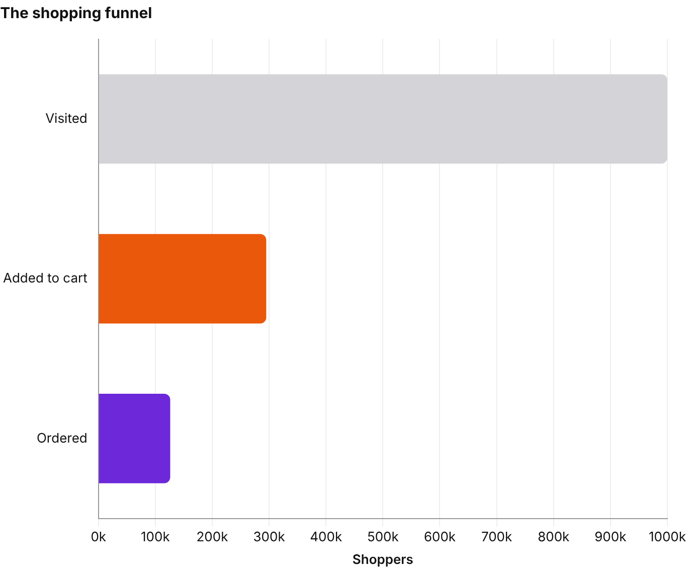
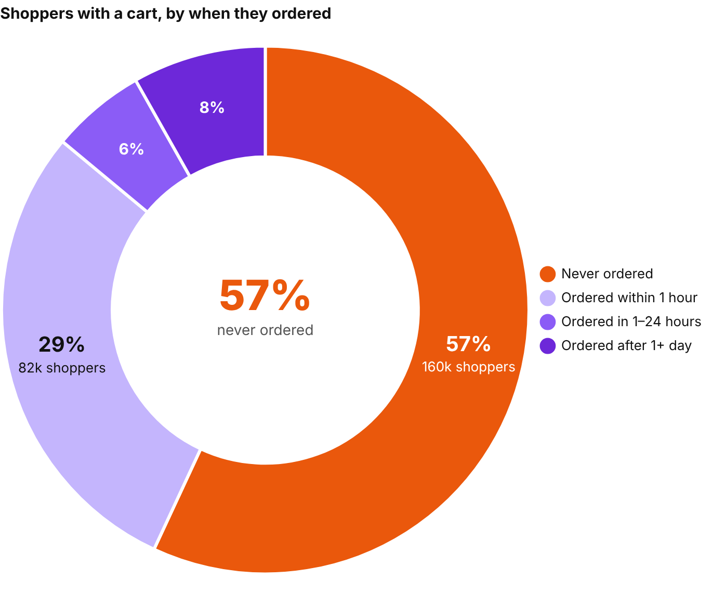
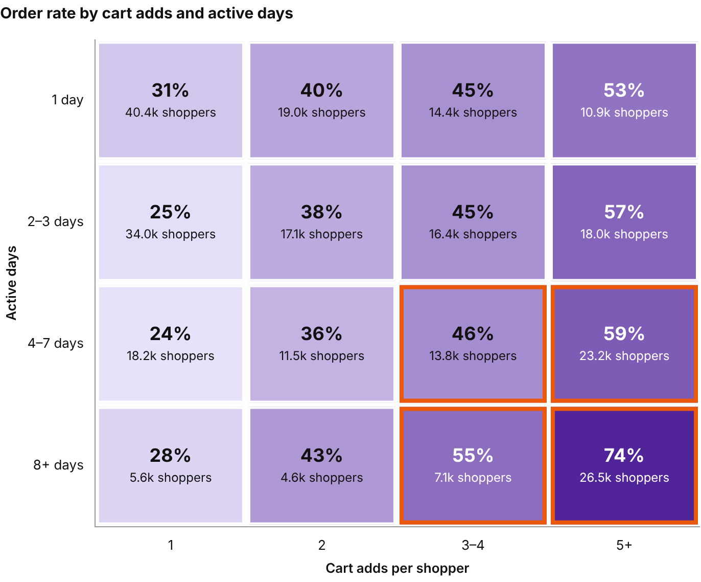
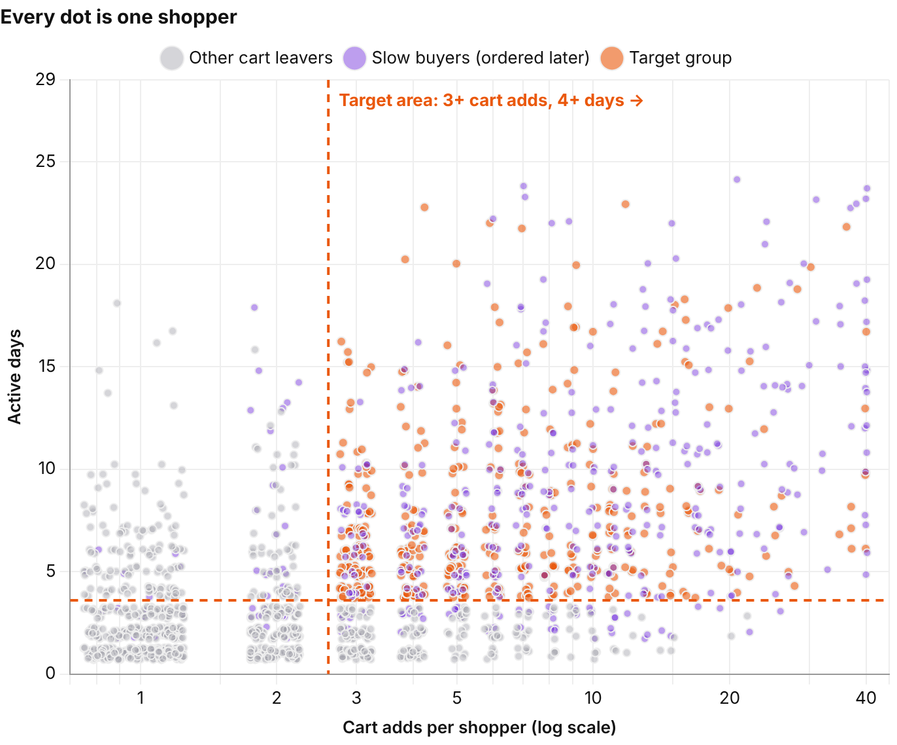
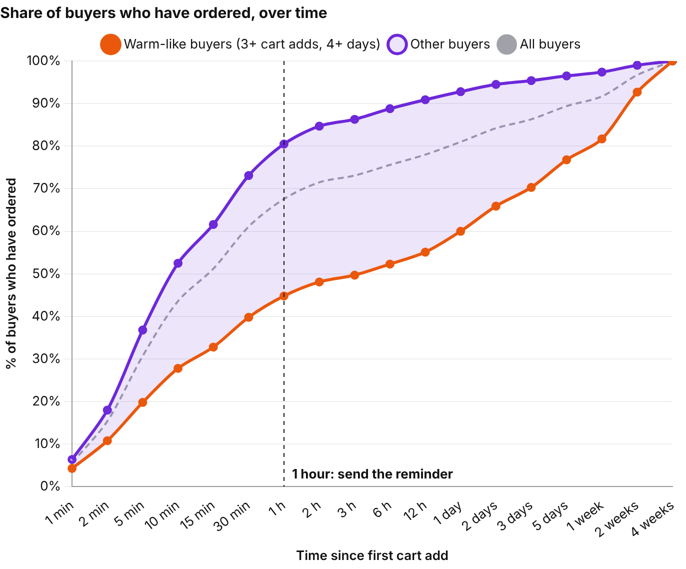
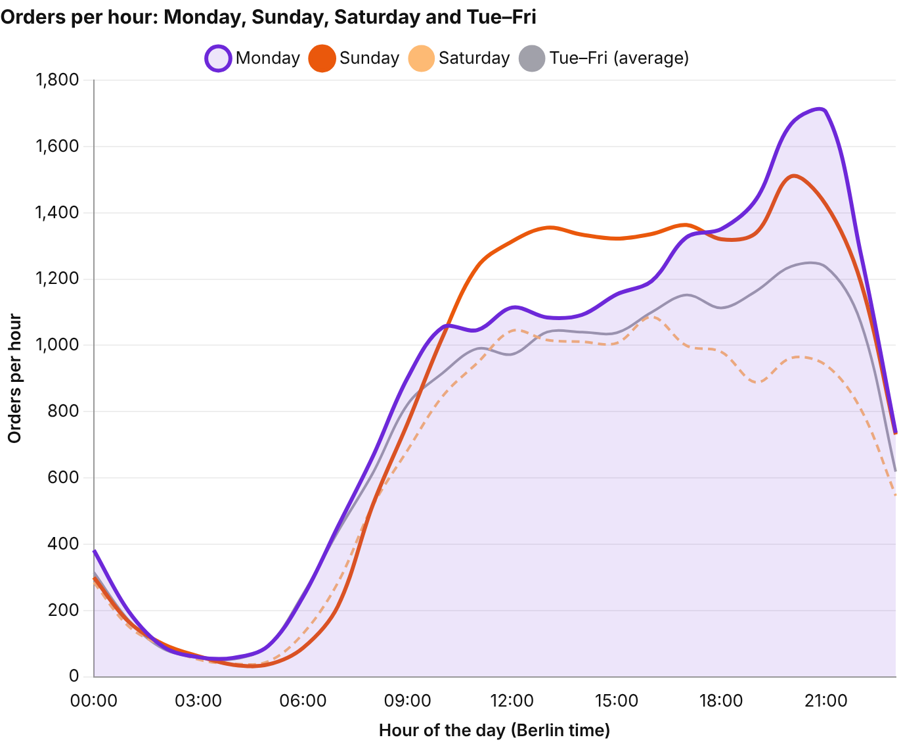
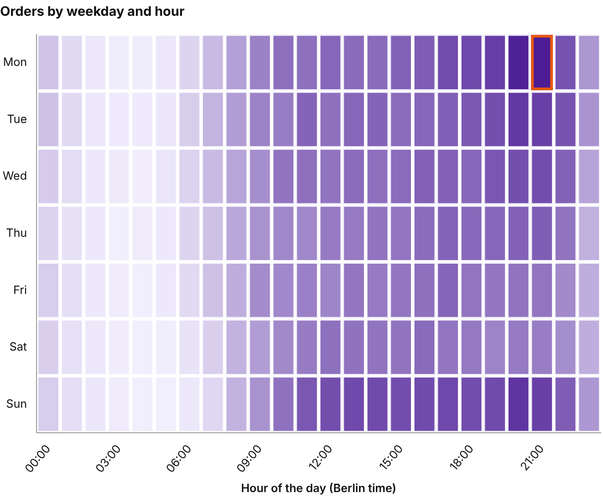
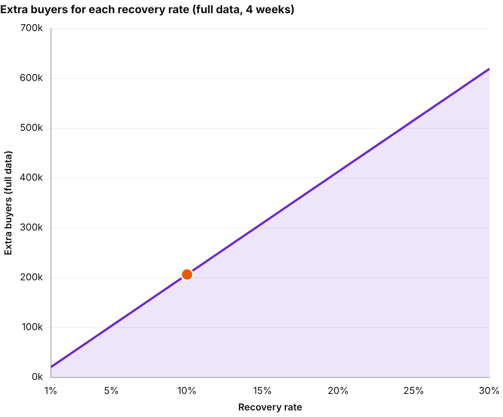
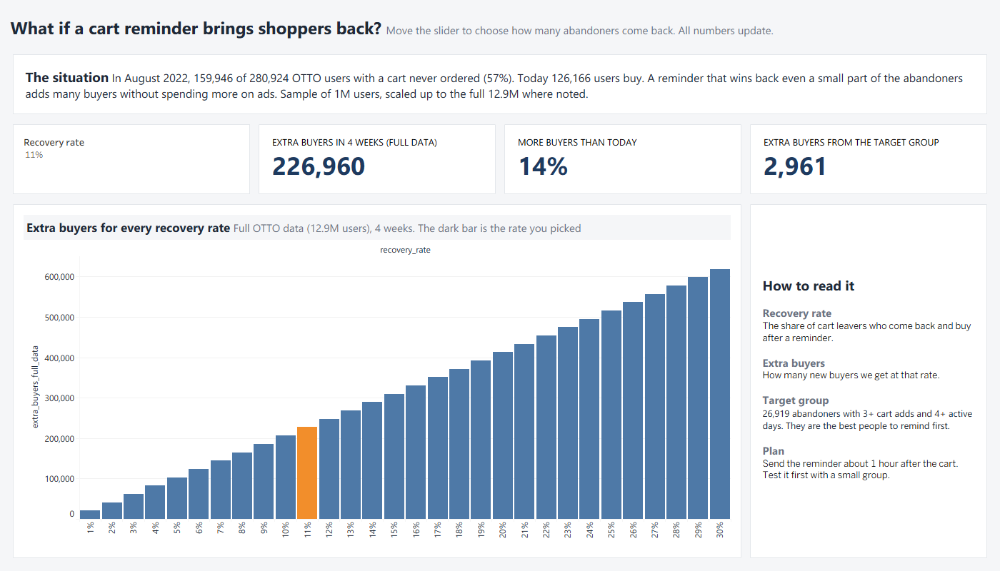

# From Click to Order: Recovering Abandoned Carts at OTTO

Cart abandonment analysis on real OTTO e-commerce data (12.9M sessions): funnel KPIs, buyer types and purchase timing to build a cart recovery plan.

**Tools:** Python (pandas, statsmodels, seaborn) · SQL · PostgreSQL · dbt · Tableau

**Presentation:** [shadishirinbeik.github.io/otto-cart-recovery](https://shadishirinbeik.github.io/otto-cart-recovery/) (interactive, scroll through the slides)

---

## Contents
1. [Business problem](#1-business-problem)
2. [KPIs](#2-kpis)
3. [Business questions](#3-business-questions)
4. [Data source](#4-data-source)
5. [Data pipeline and lineage](#5-data-pipeline-and-lineage)
6. [Repository structure](#6-repository-structure)
7. [How to reproduce](#7-how-to-reproduce)
8. [Findings](#8-findings)
9. [Limitations](#9-limitations)
10. [Acknowledgements](#10-acknowledgements)

---

## 1. Business problem

**Background.** On average, about 70% of online shopping carts are abandoned ([Baymard Institute](https://baymard.com/research/cart-abandonment-rate)). These users already wanted to buy, so every abandoned cart is a lost order.

**Goal.** Help an online shop get more orders from the visitors it already has, by recovering abandoned carts, instead of spending more on ads to get new visitors.

**Impact.** The result is a data-backed cart recovery plan that answers:
- How many orders are being lost?
- Which users should be targeted?
- When should they be contacted?

## 2. KPIs

| Type | KPI | Definition |
|---|---|---|
| Main | Cart abandonment rate | Share of users with a cart add and no order (see [data rules](#data-rules)) |
| Main | Order conversion rate | Share of all users that place at least one order |
| Outcome | Recoverable orders | Extra buyers if X% of abandoned carts were recovered |
| Supporting | Click-to-cart rate | Share of users who add something to the cart |
| Supporting | Time to purchase | Time from first cart add to first order |
| Supporting | Cart adds per user | How many times a user added something to the cart |
| Supporting | Active days per user | On how many different days a user was active |
| Supporting | Conversion rate by weekday and hour | Share of orders by time |
| Supporting | Buyer type share | Share of users in each buyer type (browser, abandoner, quick / same-day / slow buyer) |

**Success** means a measured baseline for every KPI, a clear estimate of recoverable orders, and a reminder plan (who and when) backed by statistical tests.

## 3. Business questions

| # | Question | KPI that answers it | Method |
|---|---|---|---|
| Q1 | How many customers do we lose, and how many orders could we win back? | Cart abandonment rate, order conversion rate, recoverable orders | Funnel, confidence interval, recovery scenarios (e.g. 5%, 10%, 20%) |
| Q2 | Who should we contact? | Buyer type share, cart adds and active days per user | Rule-based buyer types, order rate by cart adds × active days |
| Q3 | When should we contact them? | Time to purchase, conversion rate by weekday and hour | Time-to-purchase distribution, two-proportion z-test |

## 4. Data source

| Item | Details |
|---|---|
| Dataset | OTTO Recommender Systems Dataset, published by OTTO (German online retailer) |
| Official repository | https://github.com/otto-de/recsys-dataset |
| Download | Kaggle: https://www.kaggle.com/datasets/otto/recsys-dataset |
| Licence | CC BY 4.0 (free to use with attribution) |
| Type | Real event data (not synthetic), 1–28 August 2022 |
| Size | 12,899,779 sessions, 216,716,096 events (clicks, cart adds, orders) |
| File used | `otto-recsys-train.jsonl` (~11 GB) |

**Columns:** `session` (anonymised user ID), `aid` (anonymised product ID), `ts` (Unix timestamp in milliseconds), `type` (`clicks`, `carts`, `orders`).

**Data dictionary:** every table and column is explained in [docs/data_dictionary.md](docs/data_dictionary.md).

**Sessions.** A session holds all activity of one anonymous user in the 4 weeks. In this project, one session = one user. All IDs are anonymised; there is no personal data.

### Sample

- **What:** 1,000,000 random sessions (about 7.8%), with all events of each session, so a user's cart and order stay together. Fixed seed, so the sample can be repeated.
- **Size:** 16,857,546 events after cleaning, as a flat table (one row per event).
- **Check:** the share of clicks, carts and orders and the spread over all 28 days are almost the same as in the full data.
- **Used for:** PostgreSQL, dbt, the analysis and the dashboard. The full data is used for the overall totals and to check the sample.

### Data rules

- **Duplicates:** rows with the same session, product, type and millisecond are removed (0.16%, mostly orders).
- **Late carts:** users who added to the cart on August 27–28 and did not order are not counted as abandoners, because they may have ordered after the data period (`late_cart`).
- **Orders without a cart:** users who ordered but have no cart add in the data period (the item was added before August 1st) are left out of the abandonment and timing analysis (`other`).
- **Sessions that start with a cart or order:** the click happened before August 1st. They are kept, but left out of the time-to-purchase analysis.

**Buyer types** (column `buyer_type` in `mart_sessions`):

| Buyer type | Rule |
|---|---|
| browser | No cart add and no order |
| abandoner | Cart add, but no order |
| quick_buyer | Ordered less than 1 hour after the first cart add |
| same_day_buyer | Ordered 1–24 hours after the first cart add |
| slow_buyer | Ordered more than 24 hours after the first cart add |
| late_cart | Cart add on August 27–28, no order (excluded) |
| other | Order without a cart add in the data period (excluded) |

## 5. Data pipeline and lineage

```
Kaggle API → raw JSONL → 1M-session sample → clean events → PostgreSQL → dbt models → Python analysis → Tableau dashboard
```

| Stage | Tool | Input | Output | Location |
|---|---|---|---|---|
| Collect | Kaggle API | Kaggle dataset | `otto-recsys-train.jsonl` | `data/raw/` |
| Explore | Python (`01_data_overview.ipynb`) | Raw JSONL | Totals for the full data | `data/processed/` |
| Sample | Python (`src/make_sample.py`) | Raw JSONL | 1M random sessions as a flat table (`events_sample_raw.parquet`) | `data/processed/` |
| Clean | Python (`02_clean_sample.ipynb`) | Sample | Duplicates removed (`events_clean.parquet`, `events_clean.csv`) | `data/processed/` |
| Store | PostgreSQL | `events_clean.csv` | `otto.raw_events` table | PostgreSQL, schema `otto` |
| Transform | dbt | `otto.raw_events` | `stg_events` → `prep_sessions` → `mart_sessions` | `dbt/` |
| EDA | Python (`02b_eda.ipynb`) | `mart_sessions` | Missing values, summary statistics, group counts | `notebooks/` |
| Analyze | Python (notebooks 03–05) | dbt marts | Tests and charts | `notebooks/`, `docs/figures/` |
| Summarise | Python (`06_tableau_data.ipynb`) | dbt marts | Two what-if tables for Tableau (`whatif_base.csv`, `whatif_curve.csv`) | `dashboard/data/` |
| Visualize | Tableau | What-if tables | One-page what-if dashboard (`otto_cart_dashboard.twbx`) | `dashboard/` |

### dbt models

| Layer | Model | One row per | What it does |
|---|---|---|---|
| Staging | `stg_events` | event | Renames columns, adds Berlin time. The raw table stays unchanged. |
| Prep | `prep_sessions` | user | Counts clicks, cart adds, orders, products and active days; keeps the first click, cart and order time |
| Mart | `mart_sessions` | user | Final features: cart abandonment, hours from cart to order, order weekday and hour, buyer type, data-rule flags |

dbt tests check that every user appears only once in the mart.

## 6. Repository structure

```
otto-cart-recovery/
├── data/            # not committed (see .gitignore)
│   ├── raw/         # original Kaggle file
│   └── processed/   # sample and clean data
├── notebooks/       # exploration and analysis
├── src/             # Python scripts (sampling, chart style)
├── sql/             # SQL to create the raw table
├── dbt/             # dbt project
├── dashboard/       # Tableau workbook and its data
├── docs/            # data dictionary, charts and the presentation (index.html)
├── requirements.txt # Python packages
└── README.md
```

## 7. How to reproduce

**Prerequisites:** Python 3.10+, a PostgreSQL database, a Kaggle account, at least 20 GB of free disk space.

1. Clone the repository and create the data folders:
   ```bash
   git clone https://github.com/ShadiShirinbeik/otto-cart-recovery.git
   cd otto-cart-recovery
   mkdir -p data/raw data/processed
   ```
2. Install the Python packages:
   ```bash
   pip install -r requirements.txt
   ```
3. Download the data with the Kaggle API (requires `kaggle.json` from your Kaggle account settings):
   ```bash
   kaggle datasets download -d otto/recsys-dataset -p data/raw --unzip
   ```
4. Run `notebooks/01_data_overview.ipynb` to count the full data (about 10–15 minutes).
5. Create the sample, then run `notebooks/02_clean_sample.ipynb` to clean it and export `events_clean.csv`:
   ```bash
   python src/make_sample.py
   ```
6. Load the clean data into PostgreSQL: run `sql/01_create_raw_events.sql`, then import `data/processed/events_clean.csv` into `otto.raw_events` (for example with DBeaver's Import Data).
7. Create `dbt/profiles.yml` with your database connection (this file is not committed):
   ```yaml
   otto:
     target: dev
     outputs:
       dev:
         type: postgres
         host: YOUR_HOST
         port: 5432
         user: YOUR_USER
         password: YOUR_PASSWORD
         dbname: YOUR_DATABASE
         schema: otto
         threads: 4
   ```
8. Build and test the dbt models:
   ```bash
   cd dbt
   dbt run
   dbt test
   ```
9. Create a `.env` file in the project folder with the same connection (not committed), then run notebook 02b (EDA) and notebooks 03–06. They download the dbt tables once, save the charts in `docs/figures/` and the dashboard data in `dashboard/data/`:
   ```
   POSTGRES_USER=YOUR_USER
   POSTGRES_PASS=YOUR_PASSWORD
   POSTGRES_HOST=YOUR_HOST
   POSTGRES_PORT=5432
   POSTGRES_DB=YOUR_DATABASE
   ```
10. Open `dashboard/otto_cart_dashboard.twbx` in Tableau Desktop. The workbook holds its own copy of the two CSV files.

## 8. Findings

Results from the 1M-user sample (August 2022). Numbers for the full data are scaled up from the sample (×12.9). All charts below come from the [interactive presentation](https://shadishirinbeik.github.io/otto-cart-recovery/), where you can hover every chart for exact numbers.

### Q1. How many customers do we lose?

- 70% of users only browse. 29.5% add something to the cart, and **12.6% order** (conversion rate).
- **57% of users with a cart never order** (95% CI 56.8%–57.1%). That is 159,946 users in the sample, or about 2.1M on the full data.
- Most buyers order within the first hour, but a smaller group comes back hours or days later.

<p>
  
  
</p>

### Q2. Who should we contact?

- The number of cart adds matters most. Coming back on more days helps, mainly for users with 3+ cart adds.
- The order rate goes from 31% (1 cart add, 1 day) up to 74% (5+ cart adds, 8+ days).
- **Target group: 26,919 abandoners (17%) with 3+ cart adds and 4+ active days.** In the scatter plot they sit in the same area as slow buyers (who ordered after a day or more), not with the other abandoners.
- Users with this behaviour order 62% of the time, compared with 43% of all users with a cart.

<p>
  
  
</p>

### Q3. When should we contact them?

- **Most buyers decide fast:** half order within 14 minutes, and 68% within 1 hour.
- **Warm shoppers decide more slowly:** only 45% of buyers with 3+ cart adds and 4+ active days order within an hour, compared with about 80% of other buyers. So a reminder after about one hour reaches them while they are still deciding.
- **Evenings are the busiest time.** Monday and Sunday evenings bring the most orders; the busiest hour is Monday at 21:00. Saturday is the quietest day.
- Users who start on a weekend order less often (10.8% vs. 13.3% on weekdays, z-test p < 0.001).

<p>
  
  
</p>



### How many buyers could we win back?

| Abandoners who come back | Extra buyers (sample) | More buyers than today | Extra buyers (full data, 4 weeks) |
|---|---|---|---|
| 5% | 7,997 | +6% | ~103,000 |
| 10% | 15,995 | +13% | ~206,000 |
| 20% | 31,989 | +25% | ~413,000 |

The target group alone gives about 35,000 extra buyers on the full data at a 10% recovery rate.



### Dashboard

A one-page what-if dashboard in Tableau ([`dashboard/otto_cart_dashboard.twbx`](dashboard/otto_cart_dashboard.twbx)). Choose a recovery rate from 1% to 30% with the slider. The dashboard shows the extra buyers, how many more buyers this is than today, and the extra buyers from the target group.



### Recommendation

1. **Who:** abandoners with 3+ cart adds and 4+ active days.
2. **When:** about 1 hour after the cart add, on any day, when most fast buyers have already ordered. A second reminder works best on Sunday or Monday evening.
3. **Next step:** run an A/B test (reminder vs. no reminder) to measure the real recovery rate. The numbers above show the potential, not a proven effect.

## 9. Limitations

- No prices: results are measured in orders and buyers, not euros.
- No product names, categories, device or marketing-channel data.
- Only 4 weeks of history, so no seasonality or long-term behaviour.
- A real person using two devices may appear as two sessions.
- Cart abandonment is measured per user over 4 weeks, so it is not directly comparable with per-visit benchmarks.
- The recovery rate is an assumption. Only an A/B test can measure it.

## 10. Acknowledgements

Data: OTTO Recommender Systems Dataset by OTTO (GmbH & Co KG), licensed under CC BY 4.0. https://github.com/otto-de/recsys-dataset
